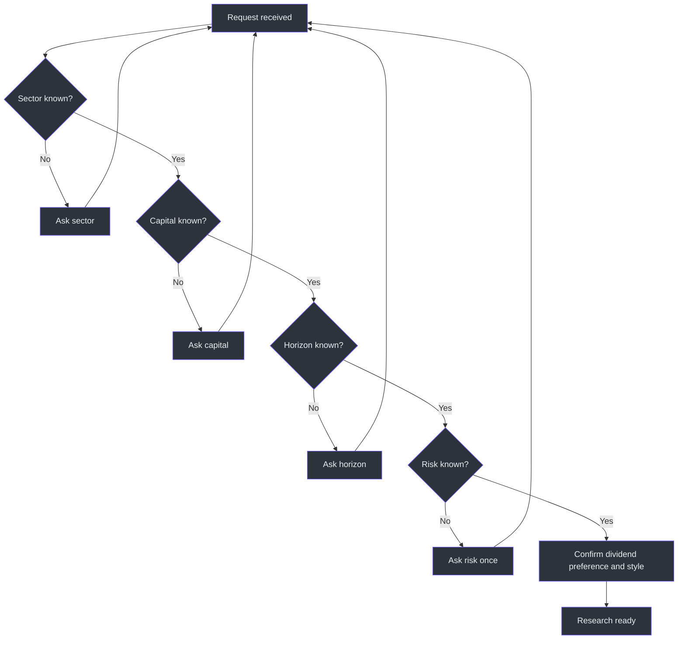
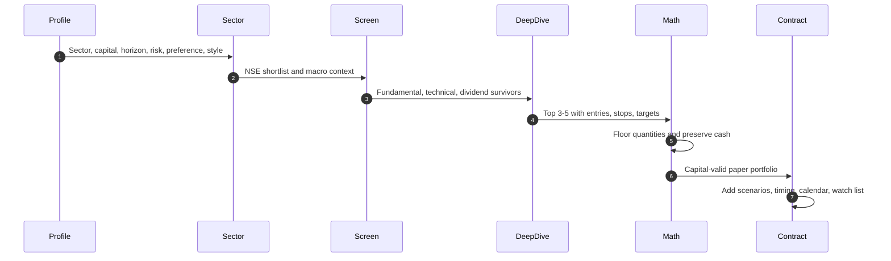

# Workflow

## 1. Invocation and intent

The skill is invoked for NSE stock recommendations, sector research, paper portfolio construction, dividend-focused selection, or follow-up management of a previously discussed virtual position. All recommendations remain educational and paper-trading outputs. (SKILL.md:L1-L3, SKILL.md:L13-L13, SKILL.md:L208-L217)

## 2. Collect the investor profile

Capture:

1. sector;
2. capital in rupees;
3. horizon;
4. risk appetite;
5. dividend preference;
6. trading style. (SKILL.md:L27-L39)

If critical data is missing, ask only one question at a time. If risk is absent, ask once whether it is Conservative, Moderate, or Aggressive, then proceed after the answer. (SKILL.md:L23-L24, SKILL.md:L40-L40)

## 3. Establish data freshness

Retrieve the latest available price, P/E, 52-week range, and financials when web search is available. Attach a date/source to LTP and other time-sensitive figures. If fresh retrieval is unavailable, label the figures `[data as of training cutoff]`; do not silently present them as live. (SKILL.md:L21-L21, SKILL.md:L88-L117)

## 4. Run sector landscape analysis

Before selecting stocks:

- explain the sector's role in India;
- list 5–8 leading NSE-listed companies by market cap;
- identify the relevant NIFTY sector index;
- compare one- and three-year performance with NIFTY 50;
- review government policy, PLI, and budget effects;
- identify global macro sensitivities;
- summarize structural drivers and risks. (SKILL.md:L48-L56)

This stage provides the context needed to interpret company valuation and technical momentum rather than screening isolated numbers.

## 5. Run the stock screener

### Fundamentals

Evaluate sector-appropriate P/E, P/B, debt, ROE, revenue growth, EPS growth, promoter ownership/pledging, and FII/DII trend. Use thresholds as preferences, not as mechanical guarantees, especially for high-P/E growth businesses. (SKILL.md:L62-L70)

### Technicals

Evaluate price versus 200 DMA, RSI(14), location within the 52-week range, volume behavior, and nearby support/resistance. The source prefers bullish 200-DMA structure, RSI `40–65`, a range position of `30–75%`, and rising up-day volume. (SKILL.md:L72-L77)

### Dividends

When requested, evaluate yield, payout sustainability, and consistency; prefer yield above `1.5%`, payout below `60%`, and at least three years of dividend growth. (SKILL.md:L79-L82)

## 6. Deep-dive the top 3–5

For each candidate, output:

- NSE ticker and company;
- market cap and capitalization class;
- dated LTP and 52-week range;
- P/E, P/B, ROE, D/E;
- TTM revenue and growth;
- TTM EPS and three-year EPS CAGR;
- promoter holding and pledge;
- 200-DMA gap, RSI, support, resistance, volume trend;
- dividend fields when relevant;
- 2–3-line thesis;
- 2–3 specific risks. (SKILL.md:L84-L117)

## 7. Add two expectation-calibration scenarios

Before final picks, include two illustrative scenarios using the required structure: one successful trade and one stop-loss case. Each includes situation, trigger, buy price, quantity, capital, stop, target, timeline, outcome, annualized return, dividend if any, and lesson. (SKILL.md:L121-L153)

Scenarios should be clearly identified as illustrations. A losing example is mandatory because the source uses it to keep the presentation honest. (SKILL.md:L153-L153)

## 8. Construct the paper portfolio

1. Choose no more than five stocks when capital is below ₹1 Lakh.
2. Assign rupee allocations aligned with risk and conviction.
3. Determine executable entry prices.
4. Calculate integer shares with `floor(allocation / entry)`.
5. Recalculate actual deployed capital.
6. Confirm the sum does not exceed total capital.
7. Keep a cash/dip-buying buffer rather than deploying 100% immediately.
8. Compute allocation percentages from actual deployed capital.
9. Attach stop-loss and target values to every pick. (SKILL.md:L20-L24, SKILL.md:L192-L200, SKILL.md:L220-L225, SKILL.md:L245-L252)

## 9. Produce the mandatory final table

Close with the exact bordered table structure specified by the source, including:

`Stock Ticker | LTP | Allocate | Shares to Buy | Entry Price | Stop-Loss | Target`

and a total row. The table cannot be omitted. (SKILL.md:L157-L175, SKILL.md:L245-L252)

## 10. Add entry timing

For every selected stock, specify:

- a confirming trigger;
- a condition under which the user should avoid entry;
- a stagger strategy, such as half now and half on a 3–5% dip, where applicable. (SKILL.md:L177-L185)

## 11. Add dividend calendar, allocation view, and watch list

Include a dividend calendar only when the selected portfolio contains dividend stocks. Always include the allocation tree with percentage, rupees, capitalization, conviction, and cash buffer. Finish with 2–3 near-miss stocks and the exact result, breakout, or macro trigger needed. (SKILL.md:L186-L204)

## 12. Apply voice after analytical completion

Present the completed analysis with confidence, Indian number formatting, `₹`, Cr/L units, bold key values/tickers, and 🟢/🔴/🟡 signals. Keep the sector section concise. Tone must not erase dates, sources, risks, uncertainty, or the paper-trading boundary. (SKILL.md:L233-L242)

## 13. Handle follow-ups

| Follow-up | Workflow |
|---|---|
| “Update me on TICKER” | Refresh price, RSI, and developments. |
| “I bought X at ₹Y” | Compare current state to entry, stop, target, and thesis; provide hold/partial-exit/add-more paper guidance. |
| “Market crashed” | Check stop-loss status before discussing perspective. |
| “Add more stocks” | Diversify into adjacent sectors. |
| “When should I sell?” | Provide target-based and time-based exit criteria. |

These behaviors are explicitly prescribed for post-recommendation interactions. (SKILL.md:L208-L217)

## Completion checklist

A recommendation is incomplete if it lacks an NSE ticker, dated LTP, stop-loss, target, capital-valid quantity, final table, entry timing, allocation buffer, or stock-specific reasoning. (SKILL.md:L17-L24, SKILL.md:L157-L204, SKILL.md:L245-L252)

