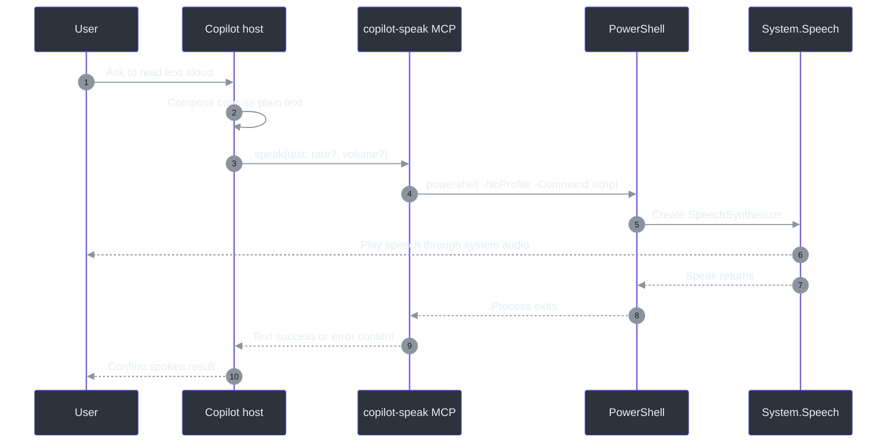

# Speak skill

## Overview

The `speak` skill gives a Copilot host a small accessibility-oriented path from a user's
request to audible Windows text-to-speech (TTS). Its normative contract is intentionally
short: activate for requests such as “say this,” “read this aloud,” or “speak”; compose
plain text; call the `speak` MCP tool; and confirm completion
(`skills\speak\SKILL.md:L6-L15`). The implementation is a Node.js MCP server that launches
Windows PowerShell and uses `System.Speech.Synthesis.SpeechSynthesizer`
(`C:\devdesk\tools\copilot-speak\mcp-server\index.mjs:L67-L87`).

This documentation separates three kinds of statements:

| Label | Meaning |
|---|---|
| **Normative** | Required by the checked-in skill contract in `SKILL.md`. |
| **Observed** | Directly visible in the external implementation snapshot. |
| **Recommendation** | Safer or clearer behavior proposed by this documentation, but not currently enforced. |

The source snapshot has two distinct layers. The repository-owned
`skills\speak\SKILL.md` defines routing and response behavior, while the implementation
under `C:\devdesk\tools\copilot-speak` supplies the plugin manifest, MCP registration,
package dependency, and executable server. The plugin manifest declares the skill
directory and points to `.mcp.json`
(`C:\devdesk\tools\copilot-speak\plugin.json:L1-L12`); `.mcp.json` starts Node with
`./mcp-server/index.mjs`
(`C:\devdesk\tools\copilot-speak\.mcp.json:L1-L8`).

## End-to-end view

The host-side preparation step matters. Markdown stripping and summarization are skill
requirements (`skills\speak\SKILL.md:L17-L21`), not server features: the handler forwards
the supplied text into a PowerShell single-quoted string after escaping only apostrophes
(`C:\devdesk\tools\copilot-speak\mcp-server\index.mjs:L67-L82`).

## Source provenance

| Source | Role | Evidence |
|---|---|---|
| `skills\speak\SKILL.md` | Normative routing, preparation, confirmation, rate guidance | `skills\speak\SKILL.md:L1-L21` |
| `C:\devdesk\tools\copilot-speak\plugin.json` | Plugin identity, version, keywords, skill and MCP entry points | `C:\devdesk\tools\copilot-speak\plugin.json:L1-L12` |
| `C:\devdesk\tools\copilot-speak\.mcp.json` | MCP server launch command and relative entry point | `C:\devdesk\tools\copilot-speak\.mcp.json:L1-L8` |
| `C:\devdesk\tools\copilot-speak\mcp-server\package.json` | Node package identity, ESM mode, SDK dependency | `C:\devdesk\tools\copilot-speak\mcp-server\package.json:L1-L10` |
| `C:\devdesk\tools\copilot-speak\mcp-server\index.mjs` | Tool schemas, PowerShell scripts, responses, timeouts, stdio startup | `C:\devdesk\tools\copilot-speak\mcp-server\index.mjs:L1-L144` |

Snapshot SHA-256 values used while preparing this suite:

| Source | SHA-256 |
|---|---|
| `skills\speak\SKILL.md` | `ADD3BFAFAC4CB75A89E47BDCDB5E8D7C5CD919DEC20DBEF188C015C9AC586C02` |
| `plugin.json` | `365EBBB2D81156EA83288EEA863D25F5BD5D051905D099C9E9A4CDB71075EFD8` |
| `.mcp.json` | `891E66ED8E766F14C6E0B696F13E0D235B01C59A11D95E51C365D22A1A812E03` |
| `mcp-server\package.json` | `08F38EBB0C1091E676F5C3F096076E140FEB02060B3A54DD0E868A3F1C05038F` |
| `mcp-server\index.mjs` | `E1192E40692D2BF55A27C0EAB3B20483D84D6DF51D9860A4BBA2B09E6AC8F853` |

These hashes identify the files read for documentation; they are not runtime integrity
checks and the implementation does not verify them.

## Contract at a glance

### Normative skill requirements

1. Activate when the user asks the assistant to say, read, speak, or voice content
   (`skills\speak\SKILL.md:L8-L10`).
2. Produce plain text without Markdown formatting before calling the tool
   (`skills\speak\SKILL.md:L12-L14`).
3. Call `speak`, optionally with a speech rate, then confirm that speech occurred
   (`skills\speak\SKILL.md:L14-L15`).
4. Strip bold, links, and code blocks; summarize long material; and keep spoken content
   concise (`skills\speak\SKILL.md:L17-L19`).
5. Treat rate `0` as the documented normal default and the supported range as `-10..10`
   (`skills\speak\SKILL.md:L20-L20`).
6. The host may speak only a partial/summary response while still presenting a complete
   written response (`skills\speak\SKILL.md:L21-L21`).

### Observed implementation behavior

- The MCP server advertises `speak` and `list_voices`
  (`C:\devdesk\tools\copilot-speak\mcp-server\index.mjs:L22-L61`).
- `speak` requires `text`; `rate` and `volume` are optional schema properties
  (`C:\devdesk\tools\copilot-speak\mcp-server\index.mjs:L30-L50`).
- The advertised and handler fallback defaults are rate `1` and volume `80`, which
  conflicts with the skill's rate-`0` guidance
  (`C:\devdesk\tools\copilot-speak\mcp-server\index.mjs:L37-L46`,
  `C:\devdesk\tools\copilot-speak\mcp-server\index.mjs:L67-L70`).
- Speech waits for the PowerShell child process and has a 60-second timeout
  (`C:\devdesk\tools\copilot-speak\mcp-server\index.mjs:L84-L87`).
- Voice listing returns PowerShell-generated JSON text and has a 10-second timeout
  (`C:\devdesk\tools\copilot-speak\mcp-server\index.mjs:L106-L131`).
- Unknown tool names produce an MCP error-shaped result with `isError: true`
  (`C:\devdesk\tools\copilot-speak\mcp-server\index.mjs:L135-L138`).

## Documentation map

| Page | Use it for |
|---|---|
| [Architecture](docs/ARCHITECTURE.md) | Plugin/host boundaries, MCP stdio lifecycle, process and trust boundaries |
| [Workflow](docs/WORKFLOW.md) | Trigger routing, text preparation, invocation, response handling |
| [Reference](docs/REFERENCE.md) | Exact tool schemas, defaults, outputs, limits, and mismatch register |
| [Examples](docs/EXAMPLES.md) | Worked calls, Markdown-to-speech transformations, and edge cases |
| [Operations and testing](docs/OPERATIONS-AND-TESTING.md) | Installation, troubleshooting, security, tests, and maintenance |

## Important known mismatch

The normative skill says “Default speech rate is 0 (normal)”
(`skills\speak\SKILL.md:L20-L20`). Both the MCP schema and handler use `1` when the caller
omits the field (`C:\devdesk\tools\copilot-speak\mcp-server\index.mjs:L37-L42`,
`C:\devdesk\tools\copilot-speak\mcp-server\index.mjs:L67-L70`). Until one source is
changed, callers that need normative behavior should pass `rate: 0` explicitly.

## Recommended reading order

1. Read [Architecture](docs/ARCHITECTURE.md) to understand what runs where.
2. Read [Workflow](docs/WORKFLOW.md) before implementing trigger or preprocessing logic.
3. Keep [Reference](docs/REFERENCE.md) open while integrating the MCP tools.
4. Use [Examples](docs/EXAMPLES.md) for concrete request/response patterns.
5. Use [Operations and testing](docs/OPERATIONS-AND-TESTING.md) before installation,
   release, or incident diagnosis.

## References

- Normative skill: `skills\speak\SKILL.md:L1-L21`
- Plugin manifest: `C:\devdesk\tools\copilot-speak\plugin.json:L1-L12`
- MCP launch configuration: `C:\devdesk\tools\copilot-speak\.mcp.json:L1-L8`
- Node package manifest: `C:\devdesk\tools\copilot-speak\mcp-server\package.json:L1-L10`
- MCP implementation: `C:\devdesk\tools\copilot-speak\mcp-server\index.mjs:L1-L144`
