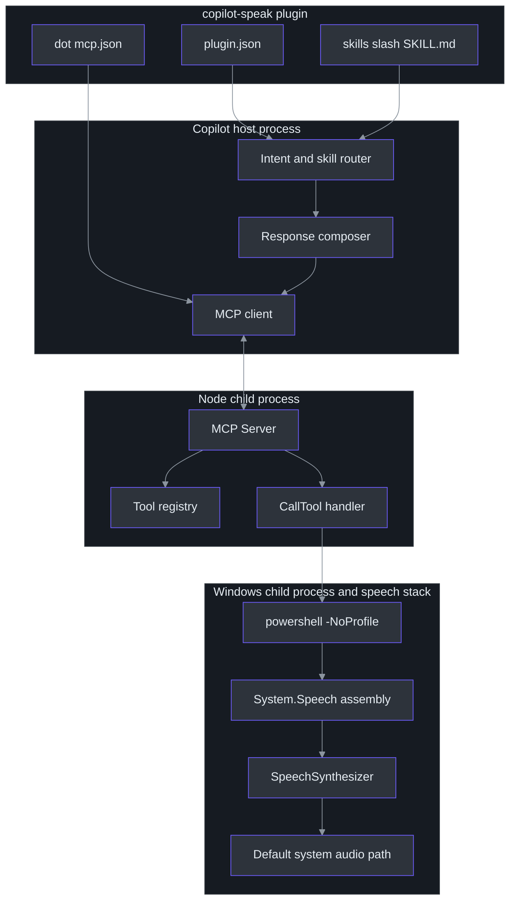
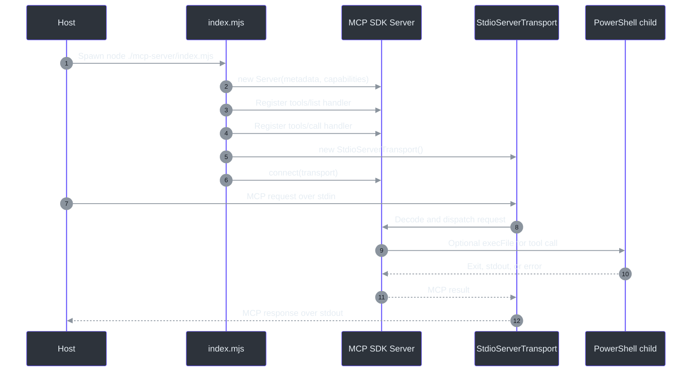
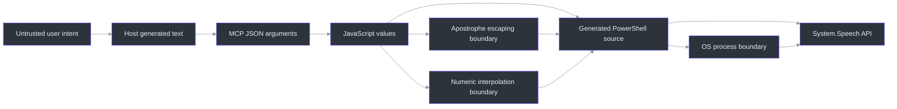

# Architecture

## Overview: why the design is layered

The feature separates conversational intent from platform-specific audio work. The skill
layer decides **when** speech is appropriate and **what** plain text should be spoken
(`skills\speak\SKILL.md:L6-L21`). The MCP layer decides **how** to turn that text into
Windows speech by invoking PowerShell and `System.Speech`
(`C:\devdesk\tools\copilot-speak\mcp-server\index.mjs:L67-L87`). This separation keeps
trigger language and summarization policy out of the operating-system adapter.

The plugin is identified as `copilot-speak` version `0.1.0`, advertises TTS/accessibility
keywords, loads skills from `skills/`, and obtains MCP server configuration from
`.mcp.json` (`C:\devdesk\tools\copilot-speak\plugin.json:L1-L12`). The Node package is an
ES module named `copilot-speak-mcp`, also version `0.1.0`, with
`@modelcontextprotocol/sdk` as its only declared dependency
(`C:\devdesk\tools\copilot-speak\mcp-server\package.json:L1-L10`).

## Component topology

### Component responsibilities

| Component | Responsibility | Classification | Evidence |
|---|---|---|---|
| Skill router | Recognize explicit speech/read-aloud requests | Normative | `skills\speak\SKILL.md:L8-L10` |
| Host composer | Produce concise, plain, Markdown-free spoken text | Normative | `skills\speak\SKILL.md:L12-L21` |
| Plugin manifest | Declare plugin metadata and entry-point locations | Observed | `C:\devdesk\tools\copilot-speak\plugin.json:L1-L12` |
| MCP launch config | Run `node ./mcp-server/index.mjs` | Observed | `C:\devdesk\tools\copilot-speak\.mcp.json:L1-L8` |
| MCP server | Advertise tools and dispatch calls | Observed | `C:\devdesk\tools\copilot-speak\mcp-server\index.mjs:L17-L64` |
| PowerShell adapter | Load `System.Speech`, configure synthesizer, speak/list voices | Observed | `C:\devdesk\tools\copilot-speak\mcp-server\index.mjs:L75-L82`, `C:\devdesk\tools\copilot-speak\mcp-server\index.mjs:L107-L114` |
| Node package | Supply MCP SDK and ESM runtime metadata | Observed | `C:\devdesk\tools\copilot-speak\mcp-server\package.json:L1-L10` |

## Plugin discovery and launch

The manifest's `skills` value is `["skills/"]`, so skill discovery is rooted in the
plugin's skill directory (`C:\devdesk\tools\copilot-speak\plugin.json:L9-L11`). Its
`mcpServers` value names `.mcp.json`, whose server record is keyed `copilot-speak` and
launches `node` with a relative script argument
(`C:\devdesk\tools\copilot-speak\.mcp.json:L1-L7`).

**Observed constraint:** because the script argument is relative, successful startup
depends on the plugin host resolving it from the plugin root, or otherwise supplying a
working directory where `.\mcp-server\index.mjs` exists. The configuration itself does
not declare an absolute path or working directory
(`C:\devdesk\tools\copilot-speak\.mcp.json:L3-L6`).

**Recommendation:** installation tests should verify the actual host working directory
instead of assuming relative-path semantics.

## MCP stdio lifecycle

The server imports `Server`, `StdioServerTransport`, the list/call request schemas, and
Node child-process utilities (`C:\devdesk\tools\copilot-speak\mcp-server\index.mjs:L6-L15`).
It constructs an MCP server named `copilot-speak`, version `0.1.0`, with tool
capabilities (`C:\devdesk\tools\copilot-speak\mcp-server\index.mjs:L17-L20`). It then:

1. Registers `ListToolsRequestSchema` to return the two advertised tool definitions
   (`C:\devdesk\tools\copilot-speak\mcp-server\index.mjs:L22-L61`).
2. Registers `CallToolRequestSchema` to dispatch by exact tool name
   (`C:\devdesk\tools\copilot-speak\mcp-server\index.mjs:L63-L67`).
3. Creates `StdioServerTransport` and awaits `server.connect(transport)`
   (`C:\devdesk\tools\copilot-speak\mcp-server\index.mjs:L141-L144`).

No explicit shutdown handler, signal handler, retry loop, or reconnect path appears in
the server source (`C:\devdesk\tools\copilot-speak\mcp-server\index.mjs:L1-L144`).
Normal lifecycle ownership therefore remains with the MCP host and the stdio transport.

## Tool registration architecture

`ListToolsRequestSchema` returns JSON-schema-like declarations for:

- `speak`, with required `text` and optional numeric `rate` and `volume`
  (`C:\devdesk\tools\copilot-speak\mcp-server\index.mjs:L25-L51`).
- `list_voices`, with an empty object input schema
  (`C:\devdesk\tools\copilot-speak\mcp-server\index.mjs:L52-L59`).

The call handler destructures `name` and `arguments` from `request.params` and branches
with `if (name === "speak")`, then `if (name === "list_voices")`
(`C:\devdesk\tools\copilot-speak\mcp-server\index.mjs:L64-L67`,
`C:\devdesk\tools\copilot-speak\mcp-server\index.mjs:L106-L106`). Any other name reaches
the explicit unknown-tool error result
(`C:\devdesk\tools\copilot-speak\mcp-server\index.mjs:L135-L138`).

## Speak execution path

For `speak`, the handler reads `args.text`, applies nullish defaults of `1` and `80`,
and doubles apostrophes in text (`C:\devdesk\tools\copilot-speak\mcp-server\index.mjs:L67-L73`).
It interpolates text, rate, and volume into a PowerShell program that:

1. Loads `System.Speech`.
2. Creates `System.Speech.Synthesis.SpeechSynthesizer`.
3. Assigns `Rate`.
4. Assigns `Volume`.
5. calls synchronous `Speak(...)`.
6. disposes the synthesizer.

Those steps are literal in
`C:\devdesk\tools\copilot-speak\mcp-server\index.mjs:L75-L82`.
Node launches `powershell` through `execFile`, not through a shell, with `-NoProfile`,
`-Command`, and the generated program as separate arguments
(`C:\devdesk\tools\copilot-speak\mcp-server\index.mjs:L84-L87`).

Because `SpeechSynthesizer.Speak` is synchronous inside the child process and the Node
handler awaits process completion, the success response is returned only after
PowerShell exits, subject to the 60-second timeout
(`C:\devdesk\tools\copilot-speak\mcp-server\index.mjs:L80-L87`).

## Voice-listing path

The `list_voices` branch creates a synthesizer, enumerates installed voices, projects
`Name`, `Gender`, `Age`, and `Culture`, serializes the pipeline with `ConvertTo-Json`,
and disposes the synthesizer
(`C:\devdesk\tools\copilot-speak\mcp-server\index.mjs:L106-L114`). Node captures stdout
with a 10-second timeout and returns stdout verbatim as text, or `No voices found.` when
stdout is empty (`C:\devdesk\tools\copilot-speak\mcp-server\index.mjs:L116-L124`).

## Trust and injection boundaries

### Text boundary

The implementation places text inside a PowerShell single-quoted literal and replaces
each `'` with `''`, which is PowerShell's escaping convention for a literal apostrophe
inside that quoting form
(`C:\devdesk\tools\copilot-speak\mcp-server\index.mjs:L72-L80`). This directly addresses
quote termination through apostrophes.

It does **not** normalize control characters, cap text length, strip Markdown, or reject
embedded newlines before constructing the script
(`C:\devdesk\tools\copilot-speak\mcp-server\index.mjs:L67-L82`). Markdown stripping is
instead assigned to the skill/host (`skills\speak\SKILL.md:L17-L19`).

### Numeric boundary

`rate` and `volume` are interpolated into executable PowerShell source without explicit
type, integer, finite-number, or range checks
(`C:\devdesk\tools\copilot-speak\mcp-server\index.mjs:L68-L79`). Their schemas call them
numbers and describe ranges, but do not declare JSON Schema `minimum` or `maximum`
keywords (`C:\devdesk\tools\copilot-speak\mcp-server\index.mjs:L37-L47`).

**Security implication:** a conforming MCP client should send numbers, but the handler
itself does not defend against a non-conforming caller supplying a source-like string.
The values cross directly into the PowerShell program. This is a source-level risk
observation, not proof that the surrounding host permits malformed arguments.

**Recommendation:** validate `Number.isInteger`, enforce `-10 <= rate <= 10` and
`0 <= volume <= 100`, then pass user text through a data channel rather than source
interpolation—for example, environment variables, stdin, or encoded arguments.

### Process boundary

Using `execFile("powershell", [...])` avoids an intermediate command shell, but
PowerShell still parses the generated `-Command` script
(`C:\devdesk\tools\copilot-speak\mcp-server\index.mjs:L84-L87`). `-NoProfile` reduces
profile-driven side effects. It does not create an OS sandbox, lower privileges, or
restrict what the PowerShell program could do.

## Resource and concurrency behavior

Each tool call creates a new PowerShell process and a new synthesizer
(`C:\devdesk\tools\copilot-speak\mcp-server\index.mjs:L75-L82`,
`C:\devdesk\tools\copilot-speak\mcp-server\index.mjs:L107-L114`). There is no queue,
mutex, cancellation token, shared synthesizer, or concurrency limit in the source
(`C:\devdesk\tools\copilot-speak\mcp-server\index.mjs:L1-L144`).

Consequences:

- Concurrent `speak` calls may produce overlapping audio, depending on Windows audio and
  synthesizer behavior.
- Every call pays process startup and assembly-loading cost.
- The 60-second timeout bounds one Node wait, but the implementation does not document
  graceful speech cancellation.
- A `list_voices` request can execute independently of a `speak` request.

These are architectural consequences of the observed per-call process model; overlap
should be verified in the target host before being treated as guaranteed behavior.

## Deployment constraints

| Constraint | Why it exists | Evidence |
|---|---|---|
| Windows runtime | The implementation loads Windows `System.Speech` through PowerShell | `C:\devdesk\tools\copilot-speak\mcp-server\index.mjs:L75-L81` |
| `powershell` executable on `PATH` | `execFileAsync` invokes that exact command name | `C:\devdesk\tools\copilot-speak\mcp-server\index.mjs:L84-L87` |
| Node.js with ESM support | Entry point is `.mjs`; package type is `module` | `C:\devdesk\tools\copilot-speak\mcp-server\package.json:L4-L6` |
| Installed npm dependency | Server imports `@modelcontextprotocol/sdk` | `C:\devdesk\tools\copilot-speak\mcp-server\package.json:L7-L9`, `C:\devdesk\tools\copilot-speak\mcp-server\index.mjs:L6-L11` |
| Installed Windows voices | Voice enumeration and speech depend on SAPI voices | `C:\devdesk\tools\copilot-speak\mcp-server\index.mjs:L107-L114` |
| Working audio route | Speech is intended to play through system speakers | `skills\speak\SKILL.md:L6-L6` |

## Architectural recommendations

1. Reconcile the rate default in the skill and server.
2. Add numeric range constraints to the schema and handler.
3. Move text and numeric values out of generated PowerShell source.
4. Add a maximum text length or chunking policy aligned with the 60-second timeout.
5. Define concurrency semantics: queue, interrupt, reject, or allow overlap.
6. Return structured voice data instead of JSON encoded inside MCP text.
7. Add explicit startup diagnostics on stderr only, preserving stdout for MCP stdio.
8. Add platform/Node checks and actionable errors before the first tool call.

## References

- Normative skill: `skills\speak\SKILL.md:L1-L21`
- Plugin manifest: `C:\devdesk\tools\copilot-speak\plugin.json:L1-L12`
- MCP launch configuration: `C:\devdesk\tools\copilot-speak\.mcp.json:L1-L8`
- Package manifest: `C:\devdesk\tools\copilot-speak\mcp-server\package.json:L1-L10`
- Server implementation: `C:\devdesk\tools\copilot-speak\mcp-server\index.mjs:L1-L144`
