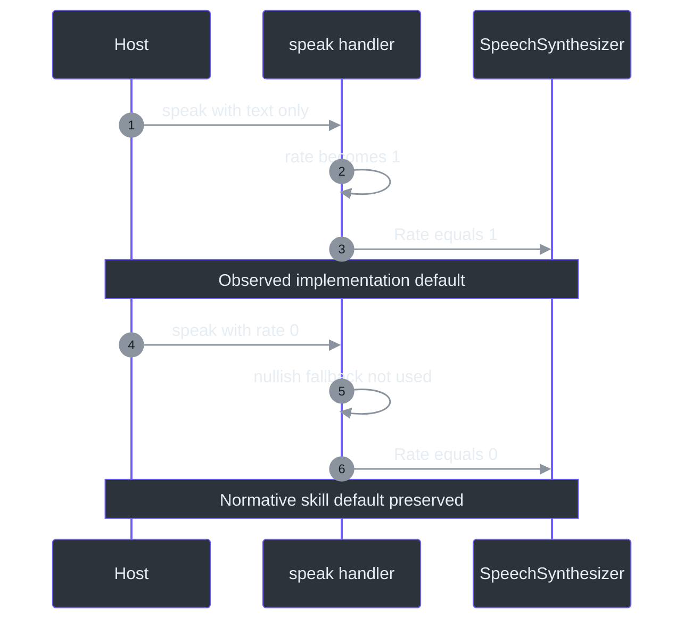

# Examples

## How to read these examples

The tool-call payloads below illustrate the schemas registered by the MCP server
(`C:\devdesk\tools\copilot-speak\mcp-server\index.mjs:L22-L61`). They are not a promise
about a particular host's UI syntax. The host should invoke the MCP tool through its
native tool mechanism rather than asking a user to type raw JSON.

The examples distinguish:

- **User request:** conversational input that should or should not trigger speech.
- **Written response:** what remains visible.
- **Spoken text:** plain text sent to the tool.
- **Tool arguments:** conceptual MCP arguments.
- **Expected result:** shape returned by the observed implementation.

The skill requires plain text, concise speech, Markdown stripping, and post-call
confirmation (`skills\speak\SKILL.md:L12-L21`).

## Example flow map

```mermaid
%%{init: {"theme":"base","themeVariables":{"background":"#161b22","primaryColor":"#2d333b","primaryBorderColor":"#6d5dfc","primaryTextColor":"#e6edf3","lineColor":"#8b949e","secondaryColor":"#161b22","tertiaryColor":"#161b22"}}}%%
flowchart LR
    Request[User request] --> Trigger{Speech requested?}
    Trigger -->|No| Written[Written response only]
    Trigger -->|Yes| Transform[Create plain spoken text]
    Transform --> Defaults{Need exact normal rate?}
    Defaults -->|Yes| Explicit[Pass rate 0]
    Defaults -->|No| Parameters[Pass validated requested values]
    Explicit --> Tool[speak tool]
    Parameters --> Tool
    Tool --> Outcome{MCP result}
    Outcome -->|success| Confirm[Confirm spoken]
    Outcome -->|isError| Fallback[Keep written answer and report failure]

    style Request fill:#2d333b,stroke:#6d5dfc,color:#e6edf3
    style Trigger fill:#2d333b,stroke:#6d5dfc,color:#e6edf3
    style Written fill:#2d333b,stroke:#6d5dfc,color:#e6edf3
    style Transform fill:#2d333b,stroke:#6d5dfc,color:#e6edf3
    style Defaults fill:#2d333b,stroke:#6d5dfc,color:#e6edf3
    style Explicit fill:#2d333b,stroke:#6d5dfc,color:#e6edf3
    style Parameters fill:#2d333b,stroke:#6d5dfc,color:#e6edf3
    style Tool fill:#2d333b,stroke:#6d5dfc,color:#e6edf3
    style Outcome fill:#2d333b,stroke:#6d5dfc,color:#e6edf3
    style Confirm fill:#2d333b,stroke:#6d5dfc,color:#e6edf3
    style Fallback fill:#2d333b,stroke:#6d5dfc,color:#e6edf3
    linkStyle default stroke:#8b949e
```



## 1. Speak an exact short phrase

**User request**

> Say “The deployment is complete.”

This matches the explicit “say this” activation pattern
(`skills\speak\SKILL.md:L8-L10`).

**Spoken text**

```text
The deployment is complete.
```

**Recommended tool arguments**

```json
{
  "text": "The deployment is complete.",
  "rate": 0
}
```

Passing `rate: 0` explicitly follows the normative skill default
(`skills\speak\SKILL.md:L20-L20`) and avoids the implementation's fallback to `1`
(`C:\devdesk\tools\copilot-speak\mcp-server\index.mjs:L67-L70`).

**Expected success content**

```text
✅ Spoke aloud: "The deployment is complete."
```

The success template is implemented at
`C:\devdesk\tools\copilot-speak\mcp-server\index.mjs:L88-L95`.

**Host confirmation**

> Spoken aloud.

Confirmation is normative after a successful call (`skills\speak\SKILL.md:L12-L15`).

## 2. Read a formatted answer aloud

**User request**

> Read your answer aloud.

**Written response**

```markdown
## Status

**Build:** Passed  
See [run 42](https://example.invalid/runs/42).
```

**Spoken text**

```text
Status. The build passed. See run 42 for details.
```

The heading marker, bold markers, Markdown link destination, and layout whitespace are
removed because the skill requires plain text and explicitly requires stripping bold,
links, and code blocks (`skills\speak\SKILL.md:L12-L18`).

**Tool arguments**

```json
{
  "text": "Status. The build passed. See run 42 for details.",
  "rate": 0,
  "volume": 80
}
```

Volume `80` matches the server's documented and handler default
(`C:\devdesk\tools\copilot-speak\mcp-server\index.mjs:L43-L47`,
`C:\devdesk\tools\copilot-speak\mcp-server\index.mjs:L69-L70`).

## 3. Speak only a summary of a long response

**User request**

> Explain the failure in detail, but just read the summary aloud.

**Written response**

The host may present the full technical analysis in writing.

**Spoken text**

```text
The deployment failed because the required Windows speech assembly could not be loaded. The written response includes the diagnostic steps.
```

This uses the skill's explicit permission to speak a partial response while typing the
full answer and its requirement to summarize long content
(`skills\speak\SKILL.md:L19-L21`).

**Tool arguments**

```json
{
  "text": "The deployment failed because the required Windows speech assembly could not be loaded. The written response includes the diagnostic steps.",
  "rate": 0
}
```

Keeping speech concise also reduces the chance that synchronous speech exceeds the
server's 60-second child timeout
(`C:\devdesk\tools\copilot-speak\mcp-server\index.mjs:L84-L87`).

## 4. User-selected slower speech

**User request**

> Read this slowly: “Backups completed successfully.”

**Tool arguments**

```json
{
  "text": "Backups completed successfully.",
  "rate": -3
}
```

The documented range is `-10..10`
(`skills\speak\SKILL.md:L20-L20`,
`C:\devdesk\tools\copilot-speak\mcp-server\index.mjs:L37-L41`). `-3` is an example
choice, not a predefined “slow” constant in the source.

## 5. User-selected volume

**User request**

> Say “Meeting starts now” at half volume.

**Tool arguments**

```json
{
  "text": "Meeting starts now.",
  "rate": 0,
  "volume": 50
}
```

The server describes volume as `0..100`
(`C:\devdesk\tools\copilot-speak\mcp-server\index.mjs:L43-L46`). The skill has no
normative volume semantics (`skills\speak\SKILL.md:L1-L21`), so mapping “half volume” to
`50` is an integration convention.

## 6. Apostrophes and contractions

**User request**

> Say “It’s ready, and Deb’s test passed.”

**Tool arguments**

```json
{
  "text": "It's ready, and Deb's test passed.",
  "rate": 0
}
```

The implementation changes each apostrophe to two apostrophes before embedding text in
the PowerShell single-quoted literal
(`C:\devdesk\tools\copilot-speak\mcp-server\index.mjs:L72-L80`). The spoken text remains
the intended contraction/possessive; the doubling is source escaping, not audible
content.

## 7. More than 80 characters

**Tool arguments**

```json
{
  "text": "This sentence is intentionally longer than eighty characters so the success receipt demonstrates preview truncation.",
  "rate": 0
}
```

**Expected receipt pattern**

```text
✅ Spoke aloud: "This sentence is intentionally longer than eighty characters so the success rece..."
```

The exact preview is the first 80 JavaScript characters plus `...`
(`C:\devdesk\tools\copilot-speak\mcp-server\index.mjs:L88-L93`). The full input is passed
to `$synth.Speak`; only the receipt is truncated
(`C:\devdesk\tools\copilot-speak\mcp-server\index.mjs:L75-L81`).

## 8. List installed voices

**User request**

> What Windows voices are installed?

**Tool arguments**

```json
{}
```

for the `list_voices` tool, whose schema has no declared properties
(`C:\devdesk\tools\copilot-speak\mcp-server\index.mjs:L52-L59`).

**Illustrative returned text**

```json
[
  {
    "Name": "Example Voice",
    "Gender": 1,
    "Age": 30,
    "Culture": "en-US"
  }
]
```

The field set is exact—`Name`, `Gender`, `Age`, `Culture`—but the values above are
illustrative. Actual values come from installed Windows voices
(`C:\devdesk\tools\copilot-speak\mcp-server\index.mjs:L107-L113`).

**Important:** listing does not enable selection. The `speak` schema lacks a voice field
and the speech script does not call `SelectVoice`
(`C:\devdesk\tools\copilot-speak\mcp-server\index.mjs:L30-L50`,
`C:\devdesk\tools\copilot-speak\mcp-server\index.mjs:L75-L82`).

## 9. Empty voice output

If PowerShell exits successfully but stdout is empty, the implementation returns:

```text
No voices found.
```

This fallback is selected with `stdout || "No voices found."`
(`C:\devdesk\tools\copilot-speak\mcp-server\index.mjs:L116-L124`). A PowerShell exception
instead follows the error response path.

## 10. Speech failure

If PowerShell is unavailable, `System.Speech` fails to load, a synthesizer assignment
fails, or the child times out, the handler returns an error-shaped result:

```json
{
  "content": [
    {
      "type": "text",
      "text": "❌ Speech failed: <runtime error message>"
    }
  ],
  "isError": true
}
```

Evidence: `C:\devdesk\tools\copilot-speak\mcp-server\index.mjs:L84-L103`.

**Recommended host reply**

> I could not play the speech. The full response remains available in writing.

Do not say “Spoken aloud” when `isError` is true.

## 11. Voice-list failure

The equivalent response starts:

```text
❌ Failed to list voices:
```

and sets `isError: true`
(`C:\devdesk\tools\copilot-speak\mcp-server\index.mjs:L125-L131`).

## 12. Unknown tool

A call named `speak_text`, `voices`, or any other unregistered name returns:

```text
Unknown tool: speak_text
```

with `isError: true`
(`C:\devdesk\tools\copilot-speak\mcp-server\index.mjs:L135-L138`). The advertised names
are exactly `speak` and `list_voices`
(`C:\devdesk\tools\copilot-speak\mcp-server\index.mjs:L25-L26`,
`C:\devdesk\tools\copilot-speak\mcp-server\index.mjs:L52-L54`).

## 13. Requests that should not automatically speak

| User request | Recommended behavior | Reason |
|---|---|---|
| “How does Windows speech work?” | Answer in writing | Topic is speech, but no audible-output request |
| “Show me the `speak` schema.” | Return reference information | No activation phrase or voice request |
| “Do not read this aloud.” | Do not call the tool | Explicit negative intent |
| “List voices.” | Call `list_voices`, not `speak` | The server exposes a dedicated discovery tool |
| “Read my password aloud.” | Warn about audible disclosure; do not expose secrets casually | Audio privacy recommendation |

The positive trigger scope comes from `skills\speak\SKILL.md:L8-L10`. Negative intent
and secret handling are recommendations because the source has no policy engine.

## 14. Markdown transformation examples

| Input | Recommended spoken text |
|---|---|
| `**Success:** backup finished.` | `Success. Backup finished.` |
| `[Open report](https://host/report)` | `Open report.` |
| ``Use `Get-Process`.`` | `Use Get-Process.` |
| `# Results` | `Results.` |
| `- One\n- Two` | `One. Two.` |
| `` | `Diagram.` or a concise alt-text description |
| Fenced source code | A short explanation, unless the user explicitly wants code read character by character |

These are recommended transformations implementing
`skills\speak\SKILL.md:L12-L19`; they are not built into the server.

## 15. Rate/default mismatch in practice



The first path follows
`C:\devdesk\tools\copilot-speak\mcp-server\index.mjs:L67-L70`; the second works because
nullish coalescing preserves numeric zero. The skill defines zero as normal
(`skills\speak\SKILL.md:L20-L20`).

## 16. Edge-case catalogue

| Input/condition | Source-level expectation | Recommendation |
|---|---|---|
| `text: ""` | Attempts to speak empty string; no explicit guard | Reject/skip at host |
| Whitespace-only text | Passed through | Trim and skip |
| `rate: 0` | Preserved | Use for normal speed |
| `volume: 0` | Preserved | Warn that success may be inaudible |
| Out-of-range rate | Interpolated; synthesizer may throw | Validate before call |
| Decimal rate | Schema allows number; synthesizer property may reject/coerce depending on binding | Require integer |
| Newline in text | Embedded in generated PowerShell string | Normalize when not semantically useful |
| Emoji | Passed as JavaScript/PowerShell text | Pronunciation depends on installed voice |
| Non-Latin language | Passed through | Verify a compatible installed voice; no voice selector exists |
| Very long text | Synchronous speech may exceed 60 seconds | Summarize or split with user awareness |
| Concurrent calls | No queue in source | Avoid overlap at host |
| Markdown code block | Spoken literally if sent unchanged | Replace with a spoken summary |

Observed processing is grounded in
`C:\devdesk\tools\copilot-speak\mcp-server\index.mjs:L67-L103`; normative preparation is
grounded in `skills\speak\SKILL.md:L12-L21`.

## References

- Normative examples and trigger basis: `skills\speak\SKILL.md:L1-L21`
- Plugin identity and accessibility intent: `C:\devdesk\tools\copilot-speak\plugin.json:L1-L12`
- MCP startup name: `C:\devdesk\tools\copilot-speak\.mcp.json:L1-L8`
- Runtime package and SDK: `C:\devdesk\tools\copilot-speak\mcp-server\package.json:L1-L10`
- Tool schemas and behavior: `C:\devdesk\tools\copilot-speak\mcp-server\index.mjs:L22-L144`
