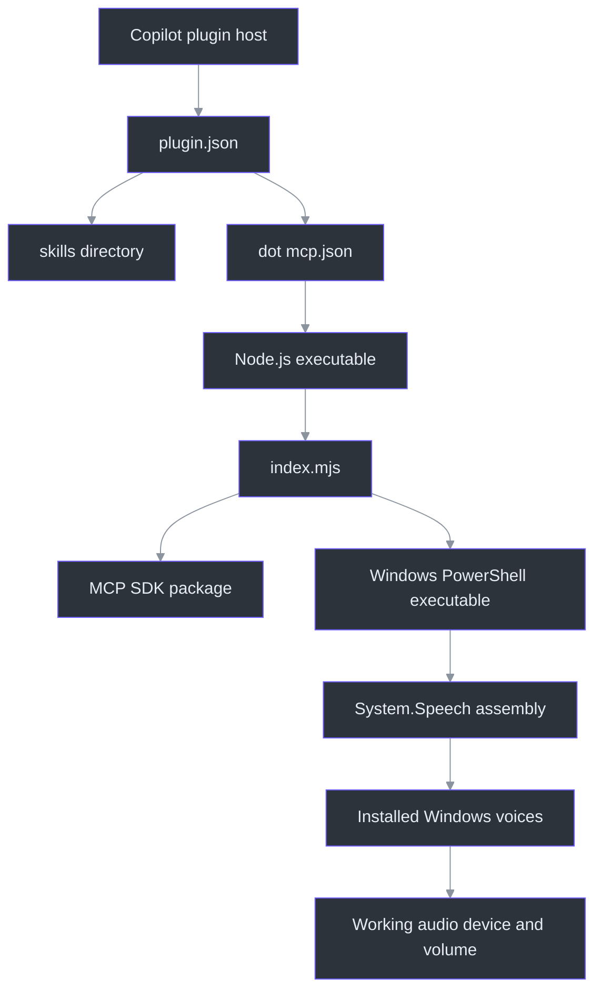
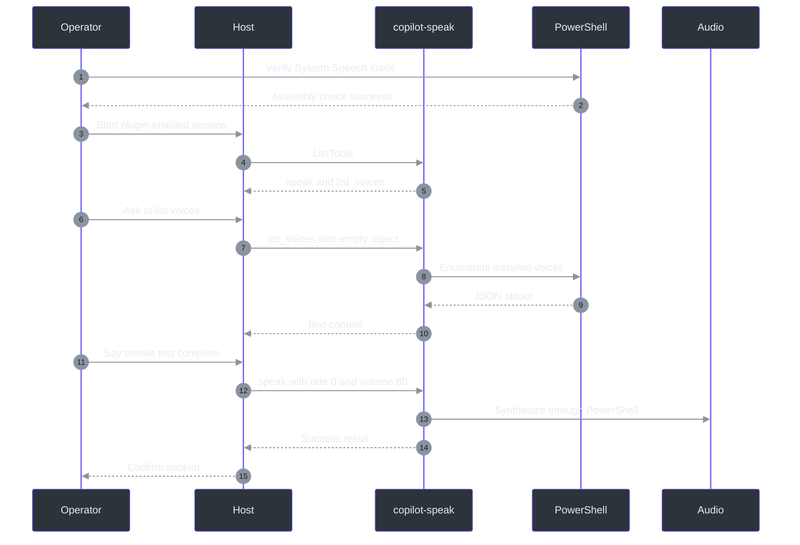
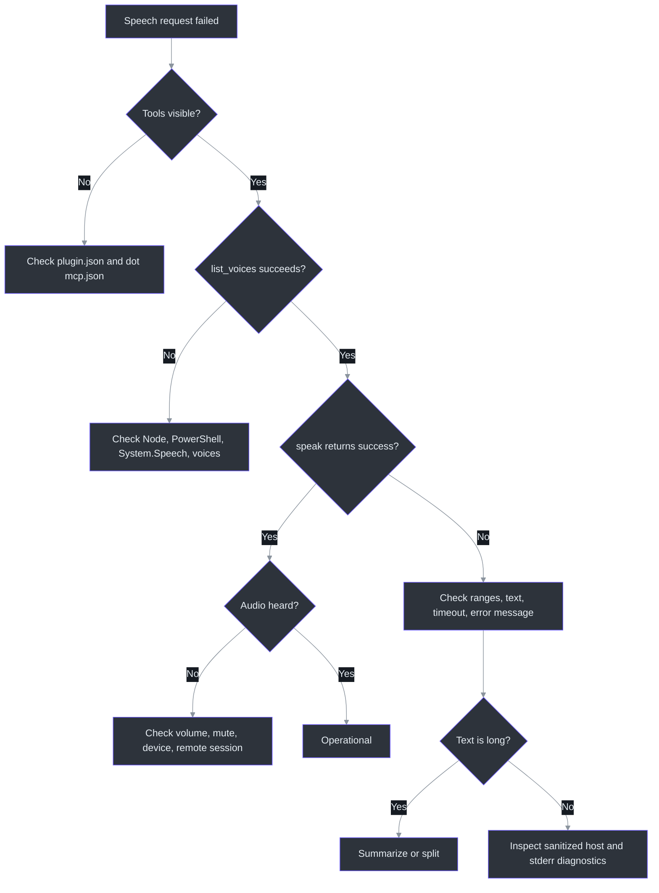

# Operations and testing

## Overview

The plugin has a narrow implementation but crosses several operational boundaries:
plugin discovery, relative-path process startup, Node/ESM dependency loading, MCP over
stdio, PowerShell process creation, .NET `System.Speech`, installed voices, and system
audio. A failure at any boundary can prevent audible output even when the skill routes
correctly.

The skill's success path requires a `speak` tool call and a user confirmation
(`skills\speak\SKILL.md:L6-L15`). The implementation's success path requires the
PowerShell child to exit before a 60-second timeout
(`C:\devdesk\tools\copilot-speak\mcp-server\index.mjs:L84-L95`).

## Runtime dependency chain



Source basis:

- Plugin discovery paths:
  `C:\devdesk\tools\copilot-speak\plugin.json:L9-L11`.
- Node launch:
  `C:\devdesk\tools\copilot-speak\.mcp.json:L1-L8`.
- ESM entry and MCP dependency:
  `C:\devdesk\tools\copilot-speak\mcp-server\package.json:L4-L9`.
- PowerShell and `System.Speech`:
  `C:\devdesk\tools\copilot-speak\mcp-server\index.mjs:L75-L87`.

## Installation checklist

The implementation snapshot does not provide an install script, lock file reference, or
declared Node engine in the files reviewed
(`C:\devdesk\tools\copilot-speak\mcp-server\package.json:L1-L10`). A practical
installation should verify each dependency explicitly.

### 1. Platform

Use Windows. The server directly loads `System.Speech` and invokes `powershell`
(`C:\devdesk\tools\copilot-speak\mcp-server\index.mjs:L75-L86`). No cross-platform
adapter appears in the source.

### 2. Node.js

Verify Node is available:

```powershell
node --version
```

The server uses ESM imports and an `.mjs` entry point
(`C:\devdesk\tools\copilot-speak\mcp-server\package.json:L4-L6`,
`C:\devdesk\tools\copilot-speak\mcp-server\index.mjs:L1-L15`). The snapshot does not
declare a minimum Node version, so compatibility must be tested rather than inferred.

### 3. Install npm dependencies

From the implementation's MCP server directory:

```powershell
Set-Location C:\devdesk\tools\copilot-speak\mcp-server
npm install
```

The only declared package dependency is `@modelcontextprotocol/sdk` with range `^1.12.0`
(`C:\devdesk\tools\copilot-speak\mcp-server\package.json:L7-L9`).

**Recommendation:** use the repository's lock file and reproducible install command if a
lock file is later added. None is established by the source set requested for this
documentation.

### 4. PowerShell and assembly

Verify the executable and assembly:

```powershell
Get-Command powershell
powershell -NoProfile -Command "Add-Type -AssemblyName System.Speech; 'System.Speech loaded'"
```

These exercise the exact executable name and assembly used by the server
(`C:\devdesk\tools\copilot-speak\mcp-server\index.mjs:L75-L86`).

### 5. Installed voices

Direct Windows check:

```powershell
powershell -NoProfile -Command "Add-Type -AssemblyName System.Speech; $s = New-Object System.Speech.Synthesis.SpeechSynthesizer; $s.GetInstalledVoices() | ForEach-Object { $_.VoiceInfo | Select-Object Name, Gender, Age, Culture }; $s.Dispose()"
```

This mirrors the tool's enumeration pipeline before JSON conversion
(`C:\devdesk\tools\copilot-speak\mcp-server\index.mjs:L107-L114`).

### 6. Plugin registration

Verify that the host loads:

- skills from `skills/`;
- MCP configuration from `.mcp.json`;
- server key `copilot-speak`;
- command `node`;
- relative entry `./mcp-server/index.mjs`.

The declarations are in `C:\devdesk\tools\copilot-speak\plugin.json:L9-L11` and
`C:\devdesk\tools\copilot-speak\.mcp.json:L1-L8`.

### 7. Audio route

Confirm the intended output device is connected, selected, and not muted. The
implementation does not select an audio device or inspect system mute state
(`C:\devdesk\tools\copilot-speak\mcp-server\index.mjs:L75-L82`).

## Startup and stdio checks

`index.mjs` connects an MCP `Server` to `StdioServerTransport`
(`C:\devdesk\tools\copilot-speak\mcp-server\index.mjs:L17-L20`,
`C:\devdesk\tools\copilot-speak\mcp-server\index.mjs:L141-L144`). When launched
manually without an MCP client, a healthy process may simply wait for protocol input.
That is not by itself proof of a hang.

Operational rules:

1. Do not write ordinary diagnostics to stdout; stdout is the MCP transport.
2. If adding diagnostics, use stderr and avoid leaking spoken content.
3. Test startup through the actual plugin host because `.mcp.json` uses a relative path.
4. Verify tool discovery returns both `speak` and `list_voices`
   (`C:\devdesk\tools\copilot-speak\mcp-server\index.mjs:L22-L61`).
5. Verify process shutdown when the host closes the transport; no custom shutdown code
   exists in the source.

## Smoke-test sequence



Recommended smoke phrase:

```text
Copilot Speak smoke test complete.
```

Use explicit `rate: 0` to test normative default behavior despite the server mismatch
(`skills\speak\SKILL.md:L20-L20`,
`C:\devdesk\tools\copilot-speak\mcp-server\index.mjs:L37-L42`,
`C:\devdesk\tools\copilot-speak\mcp-server\index.mjs:L67-L70`).

## Test matrix

The package manifest declares no test script or test dependency
(`C:\devdesk\tools\copilot-speak\mcp-server\package.json:L1-L10`). The following matrix
is therefore a recommended validation plan, not a claim that automated tests exist.

### Discovery and startup

| ID | Test | Input/setup | Expected result | Evidence basis |
|---|---|---|---|---|
| D01 | Manifest discovery | Load plugin root | Skill and MCP config are discovered | `C:\devdesk\tools\copilot-speak\plugin.json:L9-L11` |
| D02 | Relative entry | Start through real host | `index.mjs` resolves from plugin root | `C:\devdesk\tools\copilot-speak\.mcp.json:L3-L6` |
| D03 | Missing Node | Remove Node from test `PATH` | Actionable startup failure | `C:\devdesk\tools\copilot-speak\.mcp.json:L4-L5` |
| D04 | Missing SDK | Omit `node_modules` | ESM module-resolution error | `C:\devdesk\tools\copilot-speak\mcp-server\package.json:L7-L9`, `C:\devdesk\tools\copilot-speak\mcp-server\index.mjs:L6-L11` |
| D05 | Tool list | MCP `tools/list` | Exactly `speak`, `list_voices` | `C:\devdesk\tools\copilot-speak\mcp-server\index.mjs:L22-L61` |
| D06 | Server metadata | MCP initialization | Name/version `copilot-speak`/`0.1.0` | `C:\devdesk\tools\copilot-speak\mcp-server\index.mjs:L17-L20` |

### Speak functional tests

| ID | Test | Arguments | Expected source-level result |
|---|---|---|---|
| S01 | Minimal | `{"text":"Hello"}` | Rate `1`, volume `80`; success receipt if audio path works |
| S02 | Normative default | `{"text":"Hello","rate":0}` | Rate `0` preserved |
| S03 | Minimum rate | `{"text":"Hello","rate":-10}` | Synthesizer receives `-10` |
| S04 | Maximum rate | `{"text":"Hello","rate":10}` | Synthesizer receives `10` |
| S05 | Minimum volume | `{"text":"Hello","volume":0}` | Successful synthesis may be inaudible |
| S06 | Maximum volume | `{"text":"Hello","volume":100}` | Synthesizer receives `100` |
| S07 | Apostrophe | `{"text":"It's ready","rate":0}` | No PowerShell quote break |
| S08 | Multiple apostrophes | `{"text":"Deb's test isn't blocked","rate":0}` | Every apostrophe is escaped |
| S09 | Newline | Text containing newline | Script remains valid; spoken behavior observed |
| S10 | Unicode | Emoji and accented text | No process error; pronunciation voice-dependent |
| S11 | Over 80 chars | Long but short-duration text | Full speech; truncated receipt preview |
| S12 | Empty text | `{"text":""}` | Document actual behavior; recommendation is host rejection |
| S13 | Whitespace | `{"text":"   "}` | Document actual behavior; recommendation is host rejection |
| S14 | Invalid low rate | `rate:-11` | Expect synthesizer assignment error unless host blocks |
| S15 | Invalid high volume | `volume:101` | Expect synthesizer assignment error unless host blocks |
| S16 | Decimal rate | `rate:1.5` | Determine binding behavior; recommended rejection |
| S17 | Long duration | Speech exceeding 60 s | Node timeout error |
| S18 | Markdown | Raw Markdown text | Syntax is spoken literally, demonstrating host responsibility |
| S19 | Concurrent calls | Two simultaneous requests | Determine whether audio overlaps |

S01–S19 derive from the handler and PowerShell path at
`C:\devdesk\tools\copilot-speak\mcp-server\index.mjs:L67-L103`. S02 and S18 also validate
the normative contract in `skills\speak\SKILL.md:L17-L20`.

### Voice-list tests

| ID | Test | Setup | Expected result |
|---|---|---|---|
| V01 | Multiple voices | Two or more installed | JSON array text with four selected fields |
| V02 | Single voice | Exactly one installed | Potential JSON object text; consumer normalizes |
| V03 | No voices/empty stdout | Controlled empty output | `No voices found.` |
| V04 | Assembly failure | `System.Speech` unavailable | Error text plus `isError: true` |
| V05 | Timeout | Child exceeds 10 s | Error text plus `isError: true` |
| V06 | Metadata fields | Typical voices | Name, Gender, Age, Culture only |
| V07 | Selection expectation | List then call `speak` | Default voice remains; no selection parameter |

Voice behavior is implemented at
`C:\devdesk\tools\copilot-speak\mcp-server\index.mjs:L106-L131`.

### Routing and content tests

| ID | User request | Expected host behavior |
|---|---|---|
| R01 | “Say this…” | Activate `speak` |
| R02 | “Read this aloud…” | Activate `speak` |
| R03 | “Voice your answer.” | Activate `speak` |
| R04 | Ordinary question | Do not produce unsolicited audio |
| R05 | Markdown-heavy answer | Send transformed plain text |
| R06 | Long answer | Speak concise summary, preserve full written answer |
| R07 | Tool success | Confirm spoken |
| R08 | Tool error | Do not claim spoken; retain written fallback |
| R09 | “Do not speak” | Respect negative intent |
| R10 | Secret-bearing content | Avoid audible disclosure; request safer handling |

R01–R07 directly exercise `skills\speak\SKILL.md:L6-L21`. R08–R10 are recommended
privacy/error extensions.

## Troubleshooting decision tree



### Symptom table

| Symptom | Likely boundary | Checks |
|---|---|---|
| Tools absent | Plugin/MCP discovery | Verify `plugin.json` paths and `.mcp.json` load |
| Server exits immediately | Node/ESM/dependency | Run Node version check; install SDK dependency |
| `powershell` not found | Process environment | `Get-Command powershell`; inspect host `PATH` |
| `System.Speech` load error | Windows/.NET component | Run direct `Add-Type` smoke test |
| No voices returned | Windows voices | Run direct enumeration; install/enable voice |
| `Rate` or `Volume` exception | Argument validation | Keep rate `-10..10`, volume `0..100`, preferably integers |
| Speech timeout | Content duration | Shorten/summarize; server timeout is 60 s |
| Voice-list timeout | PowerShell/voice subsystem | Directly run enumeration; server timeout is 10 s |
| Success receipt but silence | Audio path or `volume:0` | Check mute, device, remote audio redirection, volume |
| Markdown read literally | Host preprocessing | Apply `SKILL.md` stripping requirements |
| Unexpected faster default | Rate mismatch | Pass `rate:0` explicitly |
| Wrong voice | Current default voice | Selection is not implemented |
| Overlapping speech | Concurrent requests | Serialize at host; implementation has no queue |

## Security and privacy review

### Audible disclosure

Speech is a physical side effect. Nearby people, remote-session audio consumers, meeting
software, or recording software may hear it. The skill is explicitly designed to output
through system speakers (`skills\speak\SKILL.md:L6-L6`). Avoid voicing secrets or
private content without explicit intent.

### Text interpolation

Text is embedded into generated PowerShell source. Apostrophes are doubled before
placement in a single-quoted literal
(`C:\devdesk\tools\copilot-speak\mcp-server\index.mjs:L72-L80`). This is an intentional
escaping boundary. The implementation does not apply a broader length/control-character
policy.

### Numeric interpolation

Rate and volume are inserted into PowerShell source without validation
(`C:\devdesk\tools\copilot-speak\mcp-server\index.mjs:L68-L79`). Although the advertised
schema says `number`, the handler should not rely solely on callers for security.

Recommended fix:

```text
assert Number.isInteger(rate)
assert -10 <= rate <= 10
assert Number.isInteger(volume)
assert 0 <= volume <= 100
```

Then transport all values as data, not generated source.

### Process privileges

The child `powershell` process inherits the server's operating-system identity and
environment; no sandbox or lower-privilege token appears in the source
(`C:\devdesk\tools\copilot-speak\mcp-server\index.mjs:L84-L87`). Protect the MCP tool
boundary from untrusted arbitrary callers.

### Error disclosure

The implementation returns `err.message` directly
(`C:\devdesk\tools\copilot-speak\mcp-server\index.mjs:L96-L103`,
`C:\devdesk\tools\copilot-speak\mcp-server\index.mjs:L125-L131`). Runtime
messages can disclose executable paths or environment details. Hosts should avoid
publishing raw errors beyond the intended user/session and should sanitize telemetry.

### Denial of service and contention

Every call spawns PowerShell and creates a synthesizer, with no queue or rate limit
(`C:\devdesk\tools\copilot-speak\mcp-server\index.mjs:L75-L87`,
`C:\devdesk\tools\copilot-speak\mcp-server\index.mjs:L107-L121`). Repeated or
concurrent calls can consume processes and create overlapping audio. Add host-side
serialization/rate limiting; server-side controls are preferable for defense in depth.

### Logs and telemetry

The successful result includes up to 80 characters of spoken content
(`C:\devdesk\tools\copilot-speak\mcp-server\index.mjs:L88-L93`). If tool responses are
logged, this preview may persist sensitive content. Recommended maintenance change:
return a content-free receipt or make previews opt-in.

## Maintenance checklist

### When the normative skill changes

1. Re-read all of `skills\speak\SKILL.md`.
2. Update trigger, preparation, default, and confirmation sections.
3. Re-run routing tests R01–R10.
4. Check whether new normative requirements are implemented or remain host-only.
5. Preserve explicit `SKILL.md:Lx-Ly` citations.

### When the implementation changes

1. Re-read:
   - `C:\devdesk\tools\copilot-speak\plugin.json`
   - `C:\devdesk\tools\copilot-speak\.mcp.json`
   - `C:\devdesk\tools\copilot-speak\mcp-server\package.json`
   - `C:\devdesk\tools\copilot-speak\mcp-server\index.mjs`
2. Refresh line-range citations and snapshot hashes.
3. Compare versions across plugin manifest, npm package, and MCP server metadata.
4. Diff tool names, schemas, defaults, timeout values, response templates, and
   PowerShell scripts.
5. Re-run discovery, speech, voice, routing, and security tests.
6. Update the mismatch register in `REFERENCE.md`.

### Release gates

| Gate | Required evidence |
|---|---|
| Source consistency | Plugin, package, and server versions agree |
| Normative consistency | Skill default and MCP default agree |
| Schema safety | Numeric min/max and required fields validated |
| Injection safety | No user-controlled values become executable source |
| Windows compatibility | Supported Windows/PowerShell/Node matrix tested |
| Voice behavior | Zero, one, and multiple voice shapes tested |
| Accessibility | Concise speech and written fallback verified |
| Privacy | Sensitive-text preview/logging reviewed |
| Reliability | Timeout, concurrency, and process cleanup tested |
| Documentation | Citations, examples, and test matrix updated |

## Recommended implementation improvements

These are not present in the observed snapshot:

1. Align default rate to either `0` everywhere or intentionally revise the skill.
2. Add JSON Schema `minimum`, `maximum`, and integer constraints where supported.
3. Add explicit handler validation independent of schema.
4. Avoid generated PowerShell source for user values.
5. Add maximum text size and documented chunking/cancellation behavior.
6. Add a voice selector or clarify that voice listing is diagnostics-only.
7. Normalize voice data and return structured MCP content when appropriate.
8. Serialize speech or expose an explicit overlap/interrupt policy.
9. Avoid returning spoken text previews by default.
10. Add automated unit tests around escaping, defaults, range checks, and response
    shaping, plus Windows integration tests for actual SAPI behavior.

## Source snapshot and drift detection

| Source | Documented SHA-256 |
|---|---|
| `skills\speak\SKILL.md` | `ADD3BFAFAC4CB75A89E47BDCDB5E8D7C5CD919DEC20DBEF188C015C9AC586C02` |
| `C:\devdesk\tools\copilot-speak\plugin.json` | `365EBBB2D81156EA83288EEA863D25F5BD5D051905D099C9E9A4CDB71075EFD8` |
| `C:\devdesk\tools\copilot-speak\.mcp.json` | `891E66ED8E766F14C6E0B696F13E0D235B01C59A11D95E51C365D22A1A812E03` |
| `C:\devdesk\tools\copilot-speak\mcp-server\package.json` | `08F38EBB0C1091E676F5C3F096076E140FEB02060B3A54DD0E868A3F1C05038F` |
| `C:\devdesk\tools\copilot-speak\mcp-server\index.mjs` | `E1192E40692D2BF55A27C0EAB3B20483D84D6DF51D9860A4BBA2B09E6AC8F853` |

Use these only to detect documentation drift. Recompute intentionally after reviewing a
source change; do not treat the values as a security trust root.

## References

- Normative skill and routing contract: `skills\speak\SKILL.md:L1-L21`
- Plugin metadata and entry points: `C:\devdesk\tools\copilot-speak\plugin.json:L1-L12`
- MCP launch command: `C:\devdesk\tools\copilot-speak\.mcp.json:L1-L8`
- Runtime dependency manifest: `C:\devdesk\tools\copilot-speak\mcp-server\package.json:L1-L10`
- Server, process, response, and timeout behavior: `C:\devdesk\tools\copilot-speak\mcp-server\index.mjs:L1-L144`
