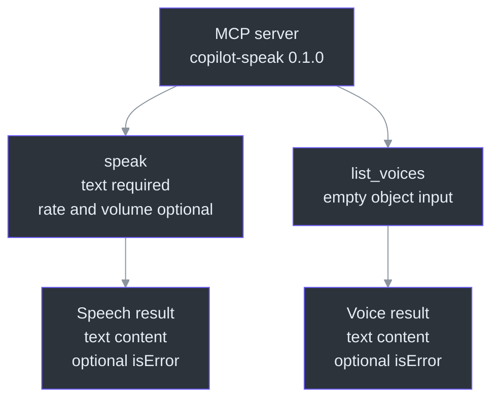
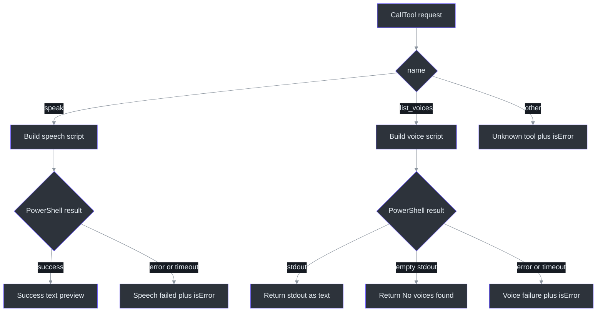

# Reference

## Scope and notation

This page is a source-level reference for the snapshot listed below. “Normative” means
required by `skills\speak\SKILL.md`; “observed” means implemented in the external plugin;
“recommended” means not currently enforced.

## Plugin metadata

The plugin manifest contains the following values
(`C:\devdesk\tools\copilot-speak\plugin.json:L1-L12`):

| Field | Value | Notes |
|---|---|---|
| `name` | `copilot-speak` | Plugin identifier |
| `description` | `Makes Copilot CLI speak its responses aloud using Windows text-to-speech` | Windows-specific intent |
| `version` | `0.1.0` | Matches server metadata and package version |
| `author.name` | `mishrad` | Declared author |
| `license` | `MIT` | Present in plugin manifest |
| `keywords` | `tts`, `speech`, `voice`, `speak`, `accessibility` | Discovery metadata |
| `skills` | `["skills/"]` | Skill directory |
| `mcpServers` | `.mcp.json` | MCP configuration file |

The MCP server independently reports name `copilot-speak` and version `0.1.0`
(`C:\devdesk\tools\copilot-speak\mcp-server\index.mjs:L17-L20`). The npm package name is
`copilot-speak-mcp`, version `0.1.0`
(`C:\devdesk\tools\copilot-speak\mcp-server\package.json:L1-L3`).

## Launch configuration

```json
{
  "mcpServers": {
    "copilot-speak": {
      "command": "node",
      "args": ["./mcp-server/index.mjs"]
    }
  }
}
```

This is the exact structural content of
`C:\devdesk\tools\copilot-speak\.mcp.json:L1-L8`. The relative entry point implies a
host/plugin-root working-directory dependency; no `cwd`, environment, or platform
condition is declared in that file.

## Runtime package

| Field | Value | Evidence |
|---|---|---|
| Package name | `copilot-speak-mcp` | `C:\devdesk\tools\copilot-speak\mcp-server\package.json:L1-L2` |
| Version | `0.1.0` | `C:\devdesk\tools\copilot-speak\mcp-server\package.json:L3-L3` |
| Module type | `module` | `C:\devdesk\tools\copilot-speak\mcp-server\package.json:L4-L4` |
| Description | `MCP server for Windows text-to-speech` | `C:\devdesk\tools\copilot-speak\mcp-server\package.json:L5-L5` |
| Main entry | `index.mjs` | `C:\devdesk\tools\copilot-speak\mcp-server\package.json:L6-L6` |
| MCP SDK | `^1.12.0` | `C:\devdesk\tools\copilot-speak\mcp-server\package.json:L7-L9` |

No npm scripts, Node `engines`, package-level license, dev dependencies, or test
dependencies are declared in the observed package manifest
(`C:\devdesk\tools\copilot-speak\mcp-server\package.json:L1-L10`).

## Tool catalogue



The server advertises both tools from its list-tools handler
(`C:\devdesk\tools\copilot-speak\mcp-server\index.mjs:L22-L61`).

## `speak`

### Purpose

Advertised description: “Speak text aloud using Windows text-to-speech. Use this to make
Copilot talk through the speakers.”
(`C:\devdesk\tools\copilot-speak\mcp-server\index.mjs:L25-L30`).

### Input schema

| Property | JSON schema type | Required | Advertised default | Advertised range | Handler fallback |
|---|---|---:|---:|---|---:|
| `text` | `string` | Yes | None | None | None |
| `rate` | `number` | No | `1` | Description says `-10..10` | `1` |
| `volume` | `number` | No | `80` | Description says `0..100` | `80` |

Schema evidence:
`C:\devdesk\tools\copilot-speak\mcp-server\index.mjs:L30-L50`.
Handler fallback evidence:
`C:\devdesk\tools\copilot-speak\mcp-server\index.mjs:L67-L70`.

Exact conceptual schema:

```json
{
  "type": "object",
  "properties": {
    "text": {
      "type": "string",
      "description": "The text to speak aloud"
    },
    "rate": {
      "type": "number",
      "description": "Speech rate from -10 (slowest) to 10 (fastest). Default: 1",
      "default": 1
    },
    "volume": {
      "type": "number",
      "description": "Volume from 0 (silent) to 100 (loudest). Default: 80",
      "default": 80
    }
  },
  "required": ["text"]
}
```

The source does not set `additionalProperties`, `minimum`, `maximum`, `minLength`, or
integer-only constraints (`C:\devdesk\tools\copilot-speak\mcp-server\index.mjs:L30-L50`).

### Argument semantics

#### `text`

- Passed to `text.replace(/'/g, "''")`, so the handler assumes a string-like value
  (`C:\devdesk\tools\copilot-speak\mcp-server\index.mjs:L67-L73`).
- Inserted into a PowerShell single-quoted string passed to `$synth.Speak(...)`
  (`C:\devdesk\tools\copilot-speak\mcp-server\index.mjs:L75-L81`).
- Not Markdown-stripped by the implementation. Stripping is normative host behavior
  (`skills\speak\SKILL.md:L17-L18`).
- Not explicitly length-limited. Effective limits include process argument size,
  PowerShell parsing, memory, and the 60-second child timeout.

#### `rate`

- Assigned to `SpeechSynthesizer.Rate`
  (`C:\devdesk\tools\copilot-speak\mcp-server\index.mjs:L75-L79`).
- Skill contract: default `0`, range `-10..10`
  (`skills\speak\SKILL.md:L20-L20`).
- Server contract/handler: default `1`
  (`C:\devdesk\tools\copilot-speak\mcp-server\index.mjs:L37-L42`,
  `C:\devdesk\tools\copilot-speak\mcp-server\index.mjs:L67-L70`).
- No source-level clamping or range validation.

#### `volume`

- Assigned to `SpeechSynthesizer.Volume`
  (`C:\devdesk\tools\copilot-speak\mcp-server\index.mjs:L75-L80`).
- Server description says `0..100`, default `80`
  (`C:\devdesk\tools\copilot-speak\mcp-server\index.mjs:L43-L47`).
- No skill-level volume rule (`skills\speak\SKILL.md:L1-L21`).
- No source-level clamping or range validation.

### PowerShell behavior

The generated script loads `System.Speech`, creates a synthesizer, sets rate and volume,
speaks synchronously, and disposes the synthesizer
(`C:\devdesk\tools\copilot-speak\mcp-server\index.mjs:L75-L82`).

Node invokes:

```text
powershell -NoProfile -Command <generated script>
```

through `execFileAsync`, with a 60,000 ms timeout
(`C:\devdesk\tools\copilot-speak\mcp-server\index.mjs:L84-L87`).

### Success result

Conceptual MCP result:

```json
{
  "content": [
    {
      "type": "text",
      "text": "✅ Spoke aloud: \"<preview>\""
    }
  ]
}
```

The preview is `text.substring(0, 80)` plus `...` only when the original JavaScript
string length exceeds 80 (`C:\devdesk\tools\copilot-speak\mcp-server\index.mjs:L88-L95`).
This truncates the **receipt preview**, not the spoken input.

### Error result

Conceptual MCP result:

```json
{
  "content": [
    {
      "type": "text",
      "text": "❌ Speech failed: <error message>"
    }
  ],
  "isError": true
}
```

The caught `err.message` is returned directly
(`C:\devdesk\tools\copilot-speak\mcp-server\index.mjs:L96-L103`).

## `list_voices`

### Input schema

The tool accepts an object with no declared properties
(`C:\devdesk\tools\copilot-speak\mcp-server\index.mjs:L52-L59`):

```json
{
  "type": "object",
  "properties": {}
}
```

### Enumeration behavior

PowerShell calls `GetInstalledVoices()`, maps each `.VoiceInfo`, selects `Name`,
`Gender`, `Age`, and `Culture`, and serializes with `ConvertTo-Json`
(`C:\devdesk\tools\copilot-speak\mcp-server\index.mjs:L107-L113`).

### Output shape

The MCP result itself is text content. The text is:

- PowerShell JSON on non-empty stdout, or
- the literal `No voices found.` on empty stdout
  (`C:\devdesk\tools\copilot-speak\mcp-server\index.mjs:L116-L124`).

Because PowerShell `ConvertTo-Json` can serialize a single pipeline item as an object and
multiple items as an array, consumers that parse the returned text should normalize
object-or-array shape. That behavior is a PowerShell interoperability consideration; the
Node source does not normalize it.

### Timeout and failure

The child timeout is 10,000 ms
(`C:\devdesk\tools\copilot-speak\mcp-server\index.mjs:L116-L121`). Caught errors return:

```json
{
  "content": [
    {
      "type": "text",
      "text": "❌ Failed to list voices: <error message>"
    }
  ],
  "isError": true
}
```

Evidence: `C:\devdesk\tools\copilot-speak\mcp-server\index.mjs:L125-L131`.

### Voice selection limitation

The list exposes voice metadata, but `speak` has no `voice` parameter and the PowerShell
speech script never calls `SelectVoice`
(`C:\devdesk\tools\copilot-speak\mcp-server\index.mjs:L30-L50`,
`C:\devdesk\tools\copilot-speak\mcp-server\index.mjs:L75-L82`). Speech therefore uses
the synthesizer's default voice in the current Windows context.

## Unknown tools

Any tool name other than exact `speak` or `list_voices` returns:

```json
{
  "content": [
    {
      "type": "text",
      "text": "Unknown tool: <name>"
    }
  ],
  "isError": true
}
```

Evidence: `C:\devdesk\tools\copilot-speak\mcp-server\index.mjs:L135-L138`.

## Response decision tree



## Normative-versus-observed matrix

| Topic | Normative skill | Observed implementation | Recommended integration behavior |
|---|---|---|---|
| Trigger | Explicit speech/read-aloud intent | Server has no trigger logic | Route only with user intent |
| Spoken format | Plain text, Markdown stripped | Speaks provided text | Preprocess before call |
| Long content | Keep concise/summarize | No length policy | Summarize or explicitly chunk |
| Rate default | `0` | `1` | Pass `0` explicitly |
| Rate range | `-10..10` | Described, not validated | Validate integer and range |
| Volume | Not defined | Default `80`, described `0..100` | Validate before call |
| Confirmation | Confirm after speaking | Returns success receipt | Confirm only on non-error result |
| Partial speech | Allowed | Any supplied text is spoken | Speak summary, keep full written answer |
| Voice listing | Not mentioned | Supported | Use for diagnostics/discovery |
| Voice selection | Not mentioned | Unsupported | Do not promise selectable voices |

Normative evidence: `skills\speak\SKILL.md:L6-L21`.
Implementation evidence:
`C:\devdesk\tools\copilot-speak\mcp-server\index.mjs:L22-L139`.

## Known mismatches and gaps

| ID | Category | Source comparison | Impact |
|---|---|---|---|
| M1 | Default mismatch | Skill rate `0`; schema/handler rate `1` | Omitted rate violates documented skill default |
| M2 | Enforcement gap | Skill says strip Markdown; server does not | Raw syntax may be spoken |
| M3 | Validation gap | Descriptions state ranges; schema/handler do not enforce | Invalid values reach PowerShell/System.Speech |
| M4 | Capability asymmetry | Voices can be listed but not selected | Discovery cannot control subsequent speech |
| M5 | Data-shape gap | Voice JSON is nested inside text and not normalized | Consumers must parse object-or-array |
| M6 | Timeout/content gap | Skill permits long content but advises summary; server hard-times out at 60 s | Long speech may fail |
| M7 | Confirmation semantics | Success means child exit, not verified audibility | Host must not claim the user heard audio |
| M8 | License metadata | Plugin says MIT; npm package has no `license` field | Packaging metadata is inconsistent |

M1 is grounded in `skills\speak\SKILL.md:L20-L20` and
`C:\devdesk\tools\copilot-speak\mcp-server\index.mjs:L37-L42` and
`C:\devdesk\tools\copilot-speak\mcp-server\index.mjs:L67-L70`.
M2 and M6 compare `skills\speak\SKILL.md:L17-L21` with
`C:\devdesk\tools\copilot-speak\mcp-server\index.mjs:L67-L87`.
M3–M5 and M7 are visible in
`C:\devdesk\tools\copilot-speak\mcp-server\index.mjs:L30-L139`.
M8 compares `C:\devdesk\tools\copilot-speak\plugin.json:L8-L8` with
`C:\devdesk\tools\copilot-speak\mcp-server\package.json:L1-L10`.

## Constraints

### Explicit source constraints

- Windows `System.Speech` and `powershell` are hard-coded
  (`C:\devdesk\tools\copilot-speak\mcp-server\index.mjs:L75-L86`).
- Speech timeout: 60 seconds
  (`C:\devdesk\tools\copilot-speak\mcp-server\index.mjs:L84-L87`).
- Voice-list timeout: 10 seconds
  (`C:\devdesk\tools\copilot-speak\mcp-server\index.mjs:L116-L121`).
- Only the default voice can speak in the current implementation.
- No output-file mode, SSML input, pause/resume, cancellation, or audio-device choice is
  exposed by either tool schema
  (`C:\devdesk\tools\copilot-speak\mcp-server\index.mjs:L25-L59`).

### Unspecified behavior

The source does not define:

- Minimum supported Node.js version.
- Minimum PowerShell version.
- Behavior on non-Windows hosts.
- Maximum input length.
- Concurrent-call policy.
- Whether the host validates input schema before dispatch.
- Guaranteed language pronunciation.
- Audio-device selection.

Treat these as unspecified, not as supported promises.

## Snapshot references

| Source | SHA-256 |
|---|---|
| `skills\speak\SKILL.md` | `ADD3BFAFAC4CB75A89E47BDCDB5E8D7C5CD919DEC20DBEF188C015C9AC586C02` |
| `C:\devdesk\tools\copilot-speak\plugin.json` | `365EBBB2D81156EA83288EEA863D25F5BD5D051905D099C9E9A4CDB71075EFD8` |
| `C:\devdesk\tools\copilot-speak\.mcp.json` | `891E66ED8E766F14C6E0B696F13E0D235B01C59A11D95E51C365D22A1A812E03` |
| `C:\devdesk\tools\copilot-speak\mcp-server\package.json` | `08F38EBB0C1091E676F5C3F096076E140FEB02060B3A54DD0E868A3F1C05038F` |
| `C:\devdesk\tools\copilot-speak\mcp-server\index.mjs` | `E1192E40692D2BF55A27C0EAB3B20483D84D6DF51D9860A4BBA2B09E6AC8F853` |

## References

- Normative skill: `skills\speak\SKILL.md:L1-L21`
- Plugin metadata: `C:\devdesk\tools\copilot-speak\plugin.json:L1-L12`
- MCP process configuration: `C:\devdesk\tools\copilot-speak\.mcp.json:L1-L8`
- Node package metadata: `C:\devdesk\tools\copilot-speak\mcp-server\package.json:L1-L10`
- MCP tool implementation: `C:\devdesk\tools\copilot-speak\mcp-server\index.mjs:L1-L144`
