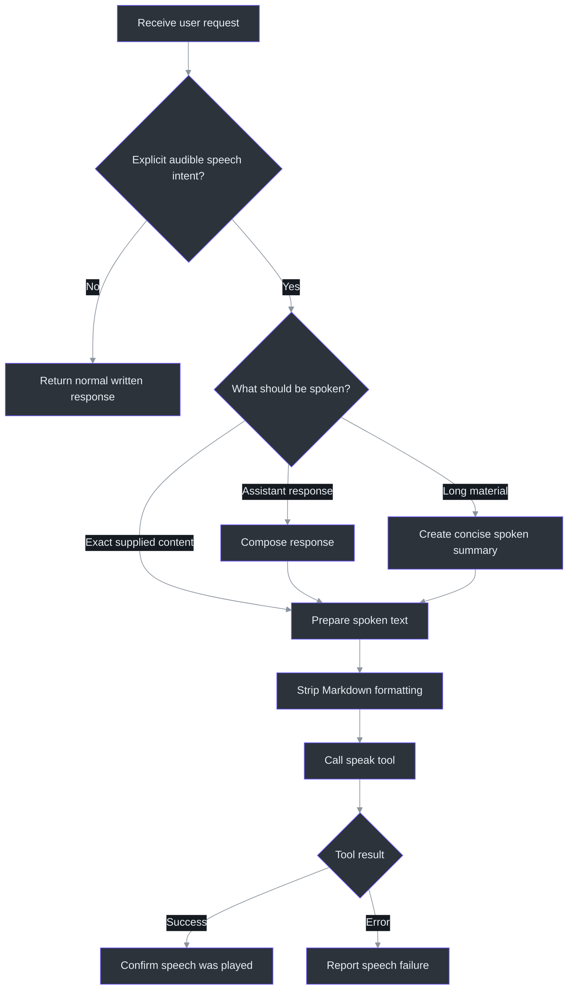
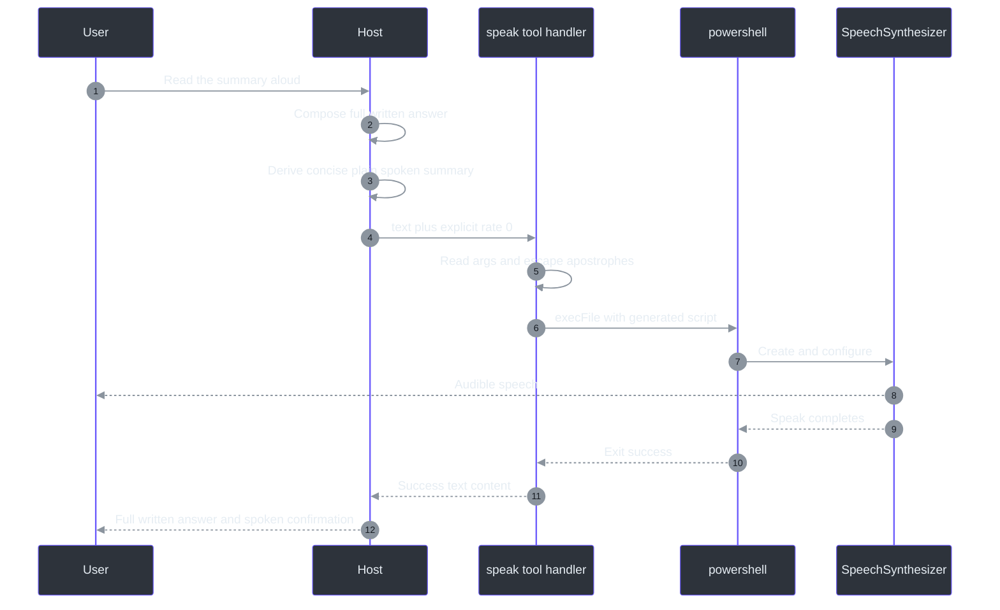
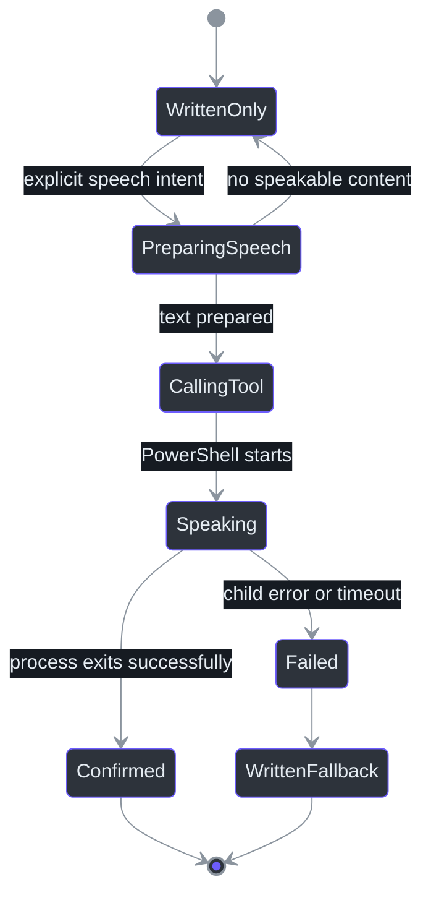

# Workflow

## Overview

The workflow begins before the MCP server is called. The skill contract tells the host
to recognize a speech-oriented request, compose a plain-text version, call `speak`, and
confirm completion (`skills\speak\SKILL.md:L6-L15`). The implementation begins only at
tool discovery/call handling; it does not inspect the original conversation for trigger
phrases (`C:\devdesk\tools\copilot-speak\mcp-server\index.mjs:L22-L64`).

This distinction is operationally important:

- **Normative skill behavior:** routing, Markdown stripping, concise summarization,
  optional partial speech, and user confirmation
  (`skills\speak\SKILL.md:L8-L21`).
- **Observed server behavior:** accept arguments, construct PowerShell, wait for it, and
  return MCP text content (`C:\devdesk\tools\copilot-speak\mcp-server\index.mjs:L64-L139`).
- **Recommendation:** validate and normalize all arguments at the server boundary even
  when the host is expected to behave correctly.

## Trigger routing

The skill is intended to activate when the user says “say this,” “read this aloud,”
“speak,” “tell me out loud,” asks the assistant to voice a response, or uses similar
language (`skills\speak\SKILL.md:L8-L10`). The frontmatter description likewise frames
the trigger as asking to say, read aloud, or speak a response
(`skills\speak\SKILL.md:L1-L4`).



### Routing guidance

| Request pattern | Route | Basis |
|---|---|---|
| “Say: deployment complete” | Speak the supplied phrase | Direct trigger in `skills\speak\SKILL.md:L8-L10` |
| “Read your answer aloud” | Compose answer, derive spoken text, invoke `speak` | `skills\speak\SKILL.md:L10-L15` |
| “Explain this long log and read the summary” | Write full analysis, speak concise summary | `skills\speak\SKILL.md:L19-L21` |
| “What voices are installed?” | Call `list_voices`; do not synthesize speech unless also asked | Tool exists at `C:\devdesk\tools\copilot-speak\mcp-server\index.mjs:L52-L59` |
| Ordinary non-audio request | Do not route to speech automatically | Trigger scope is explicit speech intent in `skills\speak\SKILL.md:L8-L10` |

**Recommendation:** do not infer consent to audible output from merely discussing speech,
TTS, voices, or accessibility. Audio can expose content to people near the machine.

## Spoken-text preparation

The skill requires plain text and explicitly names bold, links, and code blocks as
formatting to strip (`skills\speak\SKILL.md:L12-L18`). The MCP server does no Markdown
parsing; it speaks the `text` value after apostrophe escaping
(`C:\devdesk\tools\copilot-speak\mcp-server\index.mjs:L67-L80`).

### Recommended transformation pipeline

The following is a recommendation that operationalizes the skill's concise/plain-text
requirements; it is not an algorithm present in `index.mjs`.

```text
function toSpokenText(markdown, requestedScope):
    selected = selectRequestedContent(markdown, requestedScope)
    selected = removeFencedCodeOrReplaceWithShortDescription(selected)
    selected = replaceInlineCodeWithReadableText(selected)
    selected = replaceLinksWithVisibleLabels(selected)
    selected = removeHeadingMarkersAndEmphasisMarkers(selected)
    selected = verbalizeOnlyEssentialListsAndTables(selected)
    selected = normalizeWhitespace(selected)
    if selected is long:
        selected = summarizeWithoutChangingMeaning(selected)
    return selected
```

Recommended transformation rules:

| Written input | Spoken form | Reason |
|---|---|---|
| `**Warning**` | `Warning` | Remove emphasis markers |
| `[docs](https://example)` | `docs` | Avoid reading raw Markdown/URL unless requested |
| ``Run `npm install` `` | `Run npm install` | Preserve command text, remove delimiters |
| Fenced code block | Short description or selected lines | Long source code is hard to understand by audio |
| Markdown table | Concise row/column summary | Pipe syntax is not useful speech |
| Image syntax | Alt text or omit | The image bytes cannot be voiced |
| Long answer | Faithful spoken summary plus full written answer | Explicitly allowed by `skills\speak\SKILL.md:L19-L21` |

### Content safety and privacy

Before speaking, the host should avoid voicing secrets, tokens, passwords, private keys,
personal data, or content the user did not intend to make audible. This is a
recommendation based on the audio side effect; neither the skill nor server implements a
secret detector (`skills\speak\SKILL.md:L1-L21`,
`C:\devdesk\tools\copilot-speak\mcp-server\index.mjs:L1-L144`).

## Argument selection

### Text

`text` is the only required schema property
(`C:\devdesk\tools\copilot-speak\mcp-server\index.mjs:L30-L50`). The handler reads it
directly from `args.text` (`C:\devdesk\tools\copilot-speak\mcp-server\index.mjs:L67-L68`).
The source contains no empty-string, whitespace-only, length, or Unicode validation.

Recommended host behavior:

- Do not call `speak` with empty or whitespace-only text.
- Keep the spoken form concise as required by the skill
  (`skills\speak\SKILL.md:L17-L19`).
- Preserve the user's language and punctuation when they provide exact wording.
- Avoid sending Markdown after preprocessing.
- Prefer explicit verbal descriptions for symbols that speech engines may pronounce
  ambiguously.

### Rate

The skill says the default is `0`, normal, with a `-10..10` range
(`skills\speak\SKILL.md:L20-L20`). The server advertises and applies `1` when omitted
(`C:\devdesk\tools\copilot-speak\mcp-server\index.mjs:L37-L42`,
`C:\devdesk\tools\copilot-speak\mcp-server\index.mjs:L67-L70`).

Recommended decision:

1. If the user specifies a rate, pass a validated integer in `-10..10`.
2. If the user does not specify a rate and normative skill behavior is required, pass
   `rate: 0` explicitly.
3. Do not rely on omission until the mismatch is resolved.

### Volume

The skill does not define volume. The MCP schema describes `0..100`, default `80`, and
the handler also falls back to `80`
(`C:\devdesk\tools\copilot-speak\mcp-server\index.mjs:L43-L47`,
`C:\devdesk\tools\copilot-speak\mcp-server\index.mjs:L69-L70`). The schema has no
`minimum`/`maximum`, and the handler has no range check.

Recommended decision:

- Omit volume to accept implementation default `80`, or pass a validated integer
  `0..100`.
- Treat `0` as a successful but intentionally inaudible synthesis request, not proof
  that speakers are working.

## Tool-call sequence



### Server-side pseudocode

This pseudocode describes the observed branches in
`C:\devdesk\tools\copilot-speak\mcp-server\index.mjs:L64-L139`:

```text
on callTool(request):
    name, args = request.params

    if name == "speak":
        text = args.text
        rate = args.rate if not null/undefined else 1
        volume = args.volume if not null/undefined else 80
        escaped = doubleEveryApostrophe(text)
        script = createPowerShellSpeechProgram(escaped, rate, volume)
        try:
            await powershell(script, timeout=60000)
            return textContent(successPreview(text))
        catch error:
            return errorTextContent("Speech failed: " + error.message)

    if name == "list_voices":
        try:
            stdout = await powershell(voiceEnumerationScript, timeout=10000)
            return textContent(stdout or "No voices found.")
        catch error:
            return errorTextContent("Failed to list voices: " + error.message)

    return errorTextContent("Unknown tool: " + name)
```

## Success handling

On successful speech, the server returns a single text content item beginning
`✅ Spoke aloud:`. It includes at most the first 80 JavaScript characters of the original
text and appends `...` when `text.length > 80`
(`C:\devdesk\tools\copilot-speak\mcp-server\index.mjs:L88-L95`).

The skill separately requires the assistant to confirm to the user that text was spoken
(`skills\speak\SKILL.md:L12-L15`). A concise confirmation such as “Spoken aloud.” avoids
echoing potentially sensitive content a second time.

**Important limitation:** a process-level success establishes that PowerShell completed
without throwing. It does not prove that the device was unmuted, the expected output
device was selected, or the user heard the audio.

## Error handling

On a caught speech error, the server returns text beginning `❌ Speech failed:`, includes
`err.message`, and sets `isError: true`
(`C:\devdesk\tools\copilot-speak\mcp-server\index.mjs:L96-L103`). Voice-listing failures
use `❌ Failed to list voices:` with the same error flag
(`C:\devdesk\tools\copilot-speak\mcp-server\index.mjs:L125-L131`).

Recommended host response:

1. Do not claim that speech occurred.
2. Surface a concise, sanitized version of the returned error.
3. Preserve the written response so the user still receives the content.
4. Suggest a targeted check: Windows platform, PowerShell availability,
   `System.Speech`, installed voices, rate/volume range, or timeout.
5. Avoid automatically retrying audible output multiple times without warning.

## Voice discovery workflow

`list_voices` requires an empty object input and is independent of the normative
`speak` skill instructions
(`C:\devdesk\tools\copilot-speak\mcp-server\index.mjs:L52-L59`). Its PowerShell pipeline
returns `Name`, `Gender`, `Age`, and `Culture`
(`C:\devdesk\tools\copilot-speak\mcp-server\index.mjs:L107-L113`).

The `speak` schema has no `voice` property
(`C:\devdesk\tools\copilot-speak\mcp-server\index.mjs:L30-L50`). Listing voices therefore
supports inspection only; the current implementation cannot select one for a speech
call.

## State model



The state model is a recommended host workflow. The implementation itself exposes only
the request/response boundary and does not maintain conversational state
(`C:\devdesk\tools\copilot-speak\mcp-server\index.mjs:L17-L144`).

## Edge-case decisions

| Edge case | Observed behavior | Recommended host behavior |
|---|---|---|
| Omitted `rate` | Server uses `1` | Pass `0` to honor `SKILL.md` |
| `rate: 0` | Preserved by `??`, assigned to synthesizer | Preferred explicit normal rate |
| `volume: 0` | Preserved by `??`; synthesis may be inaudible | Allow only when intended |
| Apostrophe in text | Doubled before PowerShell interpolation | Supported; include in tests |
| More than 80 characters | Full text is spoken; success preview is truncated | Do not confuse preview truncation with speech truncation |
| Long speech over 60 seconds | Child may hit Node timeout | Summarize or chunk deliberately |
| Markdown input | Server speaks syntax literally | Strip at host as required |
| No installed voices | Listing may return fallback or PowerShell error | Diagnose Windows voice installation |
| One installed voice | PowerShell JSON shape may be an object rather than array | Normalize if parsing the text |
| Unknown tool | Error result | Treat as configuration/version mismatch |

## References

- Normative skill: `skills\speak\SKILL.md:L1-L21`
- Plugin routing metadata: `C:\devdesk\tools\copilot-speak\plugin.json:L1-L12`
- MCP launch configuration: `C:\devdesk\tools\copilot-speak\.mcp.json:L1-L8`
- Runtime dependency declaration: `C:\devdesk\tools\copilot-speak\mcp-server\package.json:L1-L10`
- Tool workflow implementation: `C:\devdesk\tools\copilot-speak\mcp-server\index.mjs:L22-L144`
